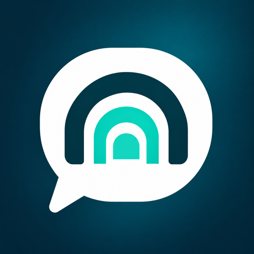

# Frp 模型对话



[](https://github.com/dneo9527-ctrl/frp-model-chat-ios/actions/workflows/checks.yml)

独立 iOS 15+ 原生 App：三组 frp STCP 配置、Ollama 模型选择、流式聊天与停止、本地多会话历史。

**[下载 1.5.0 / Build 10](https://github.com/dneo9527-ctrl/frp-model-chat-ios/releases/tag/v1.5.0)** · [安装与重签名](docs/INSTALL.md) · [隐私](docs/PRIVACY.md) · [验证与已知限制](docs/VERIFICATION.md)

发行提供未签名 IPA、与已验收程序严格对应的源码 ZIP 和 SHA-256 校验文件。未签名 IPA 需要已有兼容安装流程或自行签名，不能直接通过普通 iOS 安装流程安装。GitHub 发行未提交 App Store 或 TestFlight。

1.5.0（Build10）：新增 FRPC 锁屏实时活动（iOS 16.2+），连接、重连与停止跟随实际隧道状态，并显示配置编号和运行时长；停止完成后移除。保留纯黑与中性灰主题、模型刷新、会话管理和手动更新。卡片可被用户移除，受系统时限与后台限制；详见 [锁屏实时活动说明](docs/LIVE-ACTIVITY-1.5.0.md)。更新源默认空；协议见 [版本清单](docs/UPDATE-FEED.md)。

Bundle ID 为 `com.doc.frpmodelchat`，Keychain 服务为 `com.doc.frpmodelchat.configuration`。与原 FrpClient 使用独立身份；不会自动读取或迁移原 App 配置。保留原 App 和 IPA，在新版中自行填入配置。重新签名或修改标识仍可能影响设备上的 Keychain 访问。

首次安装三组服务器、Token、访问密钥均为空。配置保存在本机 Keychain；聊天记录保存在 App 私有目录，排除设备备份。消息通过当前 STCP 隧道发送到用户自己的远端模型；不记录提示词/回复诊断日志，无遥测。

1. 在“连接”选择配置 1/2/3，填写服务器、Token、访问密钥。高级连接选项可改目标代理、本机端口及证书校验；也可使用高级 TOML。
2. 点“保存并连接”，等待“模型接口可用”。电脑上的 Ollama、发布端 frpc 与中继 frps 需保持运行。
3. 切换“聊天”，选择模型后发送。可停止生成、创建/切换/删除会话；会话列表支持本机搜索，长按或左滑重命名。模型菜单内可刷新模型列表。不同配置及连接身份的历史隔离。
4. 停止、断网或换连接会保留已经收到的回复，不自动重发提示词。健康探针单次失败会阻止新发送，仍在运行的流可继续。

当前只接受回环聊天端点，不跟随 HTTP 重定向，不使用 Cookie、代理或持久缓存。聊天记录无法读取时保留原文件并停止写入；保存失败可重试本地保存，不会重发模型请求，请勿在成功前退出。重命名或删除写入失败会保留原会话。生成中不会每个 token 写盘，强杀可能丢失尚未落盘的部分回复。最多 96 会话，每会话 512 消息；单条输入 32 KiB，单次响应/历史有容量限制。

后台连接辅助可选，拒绝定位也可在前台使用。锁屏、低电量、网络切换与系统回收仍可能中断连接。

## 构建与测试

需要 macOS、Xcode、Go >= 1.26；依赖版本锁在 go.mod/go.sum。未签名 IPA 不可直接用普通 iOS 安装流程安装，须通过设备现有兼容的 TrollStore 或另行签名流程。

```sh
./tests/run-chat-tests.sh
./tests/run-controller-tests.sh
bash tests/run-activity-tests.sh
./tests/run-update-tests.sh
GOPROXY=off GOTOOLCHAIN=local go -C go test -race ./...
./tests/run-e2e.sh
./build.sh --unsigned
python3 tests/audit-ipa-defaults.py build/FrpClient-unsigned.ipa
```

自动 UI 验收只在新建的可丢弃模拟器运行（含测试专用 Keychain），不使用真实服务器/用户数据。先构建 xcframework，再指定模拟器 UUID：

```sh
FRP_UI_SIMULATOR_ID=<disposable-simulator-uuid> ./tests/run-ui-tests.sh
```

发布的已测/未测项见 [验证范围](docs/VERIFICATION.md)。iOS 15 是编译最低版本，不代表已经在 iOS 15 真机运行验证。更新源默认空，GitHub 下载不会自动安装更新。

`FrpModelChat-1.5.0-build10-reviewed-source.zip` 保留 Build 10 的原始 65 文件实现快照；GitHub 自动生成的源码归档还包括本仓库的发行文档、审计脚本和 CI。后续本地诊断、错误提示和手动恢复修正尚未包含在本次 IPA。应用功能不依赖 Codex Skill。

自己的代码采用 [MIT](LICENSE)，依赖许可单独保留在 [第三方声明](docs/THIRD-PARTY-NOTICES.txt)。问题和复现信息可通过 [Issues](https://github.com/dneo9527-ctrl/frp-model-chat-ios/issues) 提交；请先删除服务器、Token、密钥、聊天内容及设备标识。
